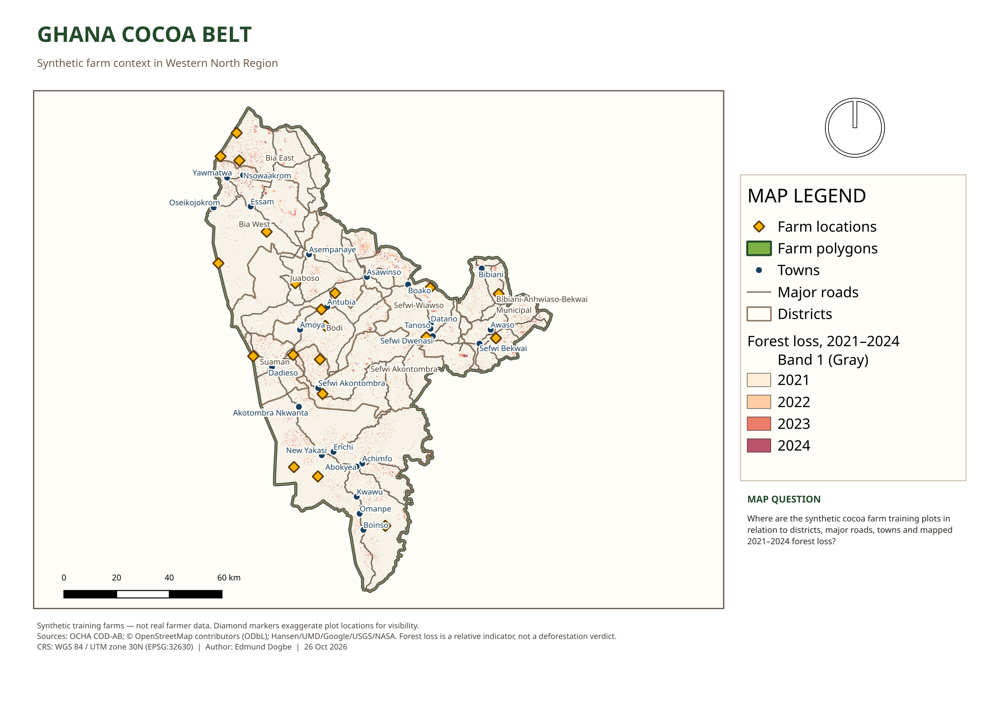

# Ghana Cocoa Belt: synthetic farm context in Western North Region

A QGIS mapping project that places 20 cocoa farm plots in the context of districts, major roads, towns and recent tree-cover loss in Ghana's Western North Region.



> [!IMPORTANT]
> **All 20 farm plots are synthetic.** I drew them for training. They do not represent real farms, farmers, ownership, yields or survey records, and must not be used for any operational, legal, compliance or commercial decision. The repository contains no real farmer data or personal information.

This is a **learning and portfolio project**. It is the capstone of the GIS and geodesy foundations phase of my geospatial software engineering roadmap. It shows a careful, documented QGIS workflow rather than a finished analytical product.

Downloads: [A4 PDF map](exports/ghana-cocoa-belt.pdf) · [PNG map](exports/ghana-cocoa-belt.png) · [QGIS project](project/ghana-cocoa-belt.qgz)

## Map question

> Where are the synthetic cocoa farm training plots in relation to districts, major roads, towns and mapped 2021–2024 forest loss in Ghana's Western North Region?

## Background and purpose

Western North is one of Ghana's main cocoa-producing regions, and also an area where forest loss is closely watched. Traceability rules such as the EU Deforestation Regulation (EUDR) have made one question common in agricultural supply chains: where is a farm plot, and how does it relate to administrative areas, infrastructure and recent forest change?

The project practises the GIS basics that sit underneath that kind of question:

- choosing the right coordinate reference system (CRS) before measuring anything
- keeping geometry valid
- joining features spatially instead of by name
- recording data provenance and licences
- presenting results honestly, with their limitations

It is a portfolio piece about method. It does not assess any real farm, supplier or compliance status.

## Skills demonstrated

- QGIS
- Vector and raster processing
- GeoPackage
- CRS transformation
- Spatial joins
- Geometry validation
- Area calculation
- OpenStreetMap data
- Cartographic design
- Reproducible geospatial workflows
- Data provenance and licensing

## QGIS workflow

1. **Study area.** Selected Western North from the Ghana ADM1 boundaries and its nine ADM2 districts. P-codes were kept for joins.
2. **Context layers.** Clipped the Geofabrik OpenStreetMap roads and places extracts to the study region (6,074 roads and 546 places).
3. **Reprojection.** Transformed all analysis layers from WGS 84 (EPSG:4326) to WGS 84 / UTM zone 30N (EPSG:32630).
4. **Synthetic farms.** Drew 20 fictional cocoa plots and calculated hectares from the projected geometry (`$area / 10000`).
5. **Quality checks.** Ran *Check Validity*, tested every pair of farms for overlap, and confirmed every farm lies inside the study region.
6. **Spatial join.** Joined each farm to its containing district (`district_name`, `district_pcode`) and generated a marker point for each plot.
7. **Forest loss.** Cropped the Hansen Global Forest Change v1.12 loss-year tile to the study boundary and reprojected it with nearest-neighbour resampling so year codes are not averaged. Only loss years 2021–2024 are kept, styled as categories.
8. **Cartography.** Styled the layers and built an A4 landscape print layout with a legend, scale bar, north arrow, map question, credits and caveats. The layout is exported to PDF (300 dpi) and PNG (220 dpi).

Display filters keep the map readable. Roads are limited to trunk, primary, secondary and tertiary classes, and places to named towns. The diamond markers are deliberately larger than the plots (0.80–6.30 ha), so they stay visible at region scale. The polygon layer is kept for closer inspection.

## Data sources and licences

| Dataset | Publisher | Version | Licence | Used for |
| --- | --- | --- | --- | --- |
| [Ghana administrative boundaries (COD-AB)](https://data.humdata.org/dataset/cod-ab-gha) | OCHA, via HDX | Resource updated 2026-08-14 | [CC BY-IGO](https://creativecommons.org/licenses/by/3.0/igo/) | Region and district boundaries |
| [Ghana OpenStreetMap extract](https://download.geofabrik.de/africa/ghana.html) | © [OpenStreetMap contributors](https://www.openstreetmap.org/copyright), extract by Geofabrik | Snapshot 2026-10-25 | [ODbL 1.0](https://opendatacommons.org/licenses/odbl/1-0/) | Roads and towns |
| [Hansen Global Forest Change](https://storage.googleapis.com/earthenginepartners-hansen/GFC-2024-v1.12/download.html) | Hansen/UMD/Google/USGS/NASA | v1.12 (loss years 2001–2024) | [CC BY 4.0](https://creativecommons.org/licenses/by/4.0/) | 2021–2024 tree-cover loss |
| Synthetic farm plots | Author | 2026 | MIT, with this repository | Training plots only |

Hansen citation: Hansen, M. C. et al. (2013). High-Resolution Global Maps of 21st-Century Forest Cover Change. *Science* 342, 850–853. [doi:10.1126/science.1244693](https://doi.org/10.1126/science.1244693).

The optional OpenStreetMap basemap streams tiles from `tile.openstreetmap.org` and is hidden by default. Use it only within the [OSM tile usage policy](https://operations.osmfoundation.org/policies/tiles/).

The full download manifest, checks and processing log are in [docs/SOURCES.md](docs/SOURCES.md).

## CRS decision

| Purpose | CRS | Why |
| --- | --- | --- |
| Exchange (GPS, GeoJSON, source downloads) | WGS 84, [EPSG:4326](https://epsg.io/4326) | Global latitude/longitude standard. Its units are degrees, so it is unsuitable for area. |
| Measurement, analysis and mapping | WGS 84 / UTM zone 30N, [EPSG:32630](https://epsg.io/32630) | Western North lies in UTM zone 30N. Coordinates are in metres and local distortion is low. |

Measuring the same plot (`FARM-001`) three ways shows why this matters:

| Method | Result |
| --- | ---: |
| Planar area in EPSG:4326 | 0.0000006537 degree² (meaningless as an area) |
| EPSG:32630, UTM zone 30N | **0.80 ha** (trusted) |
| EPSG:32631, UTM zone 31N | 0.8087 ha (about 1.09% too large outside its zone) |

All layers in `data/processed/` are stored in EPSG:32630. See [docs/crs-decisions.md](docs/crs-decisions.md) for the full reasoning and diagnostics.

## Geometry validity and overlap checks

| Check | Result |
| --- | ---: |
| Synthetic farm polygons | 20 |
| Invalid farm geometries (GEOS validity) | 0 |
| Overlapping farm pairs (shared area > 0) | 0 |
| Farms outside Western North | 0 |
| Farms with missing area | 0 |
| Farms with missing district | 0 |
| Stored `area_ha` versus recomputed geometry area | Matches (difference < 0.0001 ha) |

## Spatial join and area results

Every farm was joined to exactly one of the region's nine districts.

| District | Farms | Area (ha) |
| --- | ---: | ---: |
| Aowin | 3 | 7.4 |
| Bia East | 3 | 8.7 |
| Bia West | 2 | 6.0 |
| Bibiani-Anhwiaso-Bekwai Municipal | 2 | 6.6 |
| Bodi | 2 | 7.3 |
| Juaboso | 2 | 7.9 |
| Sefwi Akontombra | 2 | 8.6 |
| Sefwi-Wiawso | 2 | 9.2 |
| Suaman | 2 | 9.9 |
| **Total** | **20** | **71.6** |

Plot areas range from 0.80 to 6.30 ha, with a mean of 3.58 ha. Because the plots are synthetic, these figures validate the workflow. They say nothing about cocoa production.

## Forest-loss interpretation

> [!WARNING]
> Hansen tree-cover loss is a **relative indicator of stand-replacing disturbance**. It is not a deforestation verdict, a legal assessment, a land-use classification or evidence of EUDR (non-)compliance. Loss can come from plantation harvest, fire, storms or clearing, and the 30 m (1 arc-second) product misses small or gradual change. Any real decision needs higher-resolution imagery, ground truth and expert review.

- Values 21–24 mean loss was first detected in 2021–2024. Earlier loss and no-loss pixels are not displayed.
- The raster ends at 2024, so the map says nothing about later change.
- Counting pixels gives a rough footprint of about 10,400 ha (2021), 16,100 ha (2022), 10,900 ha (2023) and 10,800 ha (2024). These are pixel counts after reprojection, not bias-corrected area estimates. Do not quote them as official deforestation statistics.
- A farm marker near loss pixels does **not** mean that farm caused, or is linked to, that loss. The farms are fictional.

## Repository structure

```text
ghana-cocoa-belt-qgis/
├── README.md
├── LICENSE
├── .gitignore
├── project/
│   └── ghana-cocoa-belt.qgz              # QGIS project with relative paths and print layout
├── data/
│   └── processed/
│       ├── ghana-cocoa-belt.gpkg         # six EPSG:32630 vector layers
│       └── forest_loss_2021_2024.tif     # Hansen loss years 2021–2024, EPSG:32630
├── exports/
│   ├── ghana-cocoa-belt.pdf              # A4 landscape map, 300 dpi
│   └── ghana-cocoa-belt.png              # same layout, 220 dpi
├── docs/
│   ├── SOURCES.md                        # provenance, licences, processing log
│   └── crs-decisions.md                  # CRS choices and measurement experiment
└── scripts/
    └── finalize_qgis_project.py          # PyQGIS styling, layout and export script
```

GeoPackage layers:

| Layer | Geometry | Features | Contents |
| --- | --- | ---: | --- |
| `study_region_utm30n` | Polygon | 1 | Western North Region |
| `districts_utm30n` | Polygon | 9 | Districts with ADM2 P-codes |
| `roads_utm30n` | MultiLineString | 6,074 | OSM roads, all classes |
| `places_utm30n` | Point | 546 | OSM places, all classes |
| `farms_with_district` | Polygon | 20 | Synthetic plots with `area_ha` and joined district |
| `farm_markers` | Point | 20 | One display marker per synthetic plot |

## Open the project in QGIS

You need **QGIS 3.40 LTR or newer** ([download](https://qgis.org/download/)).

1. Clone or download this repository:

   ```bash
   git clone https://github.com/GeekKwame/ghana-cocoa-belt-qgis.git
   ```

2. In QGIS, choose **Project → Open** and select `project/ghana-cocoa-belt.qgz`. Keep the folder structure intact, because layer paths are relative to `project/`.
3. To see the finished map, open **Project → Layouts → Ghana Cocoa Belt — Western North**.
4. Optionally, tick **OpenStreetMap basemap (online; optional)** for background tiles. This needs an internet connection.

The map renders with Noto Sans. If that font is not installed, QGIS substitutes another and the layout text may shift slightly.

## Reproducibility

**Rebuild the styling, layout and exports** from the included data. This needs a Linux QGIS install with PyQGIS under `/usr`; the script uses that prefix and the bundled north-arrow SVG.

```bash
QT_QPA_PLATFORM=offscreen python3 scripts/finalize_qgis_project.py
```

The script overwrites `project/ghana-cocoa-belt.qgz` and both files in `exports/`. Review the diff before committing. A test run on a clean copy of this repository reproduced the PDF and PNG and passed every check above.

**Rebuild the processed data** from the original sources:

1. Download the three datasets from the publisher links in [docs/SOURCES.md](docs/SOURCES.md), using the recorded versions.
2. Follow the processing log in that file: select and clip, reproject to EPSG:32630, calculate area, validate, check overlaps, join districts, then crop, reproject and filter the Hansen tile.
3. Re-run the checks: 20 valid, non-overlapping farms, each with an area and a district.

Raw downloads are not redistributed here. They are large, and their publishers are the authoritative source. The OSM extract changes daily, so a fresh download will differ slightly from the 2026-10-25 snapshot.

## Limitations

- The farm plots, survey dates and attributes are synthetic training data.
- OpenStreetMap completeness and tagging depend on contributor activity, and only major roads and named towns are shown.
- Administrative boundaries provide context. They are not cadastral or survey boundaries, and COD-AB does not fully match the older 2010 census structure.
- Hansen data is a 30 m global product with the caveats above. Pixel counts are not definitive areas.
- UTM zone 30N suits Western North. Analysis covering eastern Ghana (zone 31N) or the whole country needs a different CRS or geodesic measurement.
- The forest-loss legend shows QGIS's default "Band 1 (Gray)" heading, and the map is a static snapshot from 26 October 2026.

## Future improvements

- Report the share of each district affected by forest loss, plus per-farm loss within a buffer, using equal-area or geodesic calculations.
- Add protected areas and forest reserves to provide context for plots near reserve boundaries.
- Script the full raw-to-processed pipeline (GDAL/OGR or PyQGIS processing) with pinned versions and automated tests.
- Add continuous integration that checks geometry validity, overlaps, CRS and relative paths on every commit.
- Publish an interactive web map (for example MapLibre or Leaflet) alongside the static layout.
- Tidy the legend heading and add an inset map that locates Western North within Ghana.

## Author

**Blessing Edmund Kwame Dogbe**, geospatial software engineering portfolio

- GitHub: [@GeekKwame](https://github.com/GeekKwame)
- Portfolio website: _coming soon_ <!-- TODO: replace with your portfolio URL, e.g. [yourname.dev](https://yourname.dev) -->

## Licence

The original code, documentation and synthetic farm data in this repository are released under the [MIT Licence](LICENSE).

**Third-party data keeps its original licence.** The MIT Licence does not apply to it:

- OpenStreetMap data (roads and towns): © OpenStreetMap contributors, [ODbL 1.0](https://opendatacommons.org/licenses/odbl/1-0/)
- Ghana administrative boundaries: OCHA / HDX, [CC BY-IGO](https://creativecommons.org/licenses/by/3.0/igo/)
- Hansen Global Forest Change: Hansen/UMD/Google/USGS/NASA, [CC BY 4.0](https://creativecommons.org/licenses/by/4.0/)

The processed layers in `data/processed/` and the exported maps contain or derive from these datasets, so their attribution and licence terms still apply.
